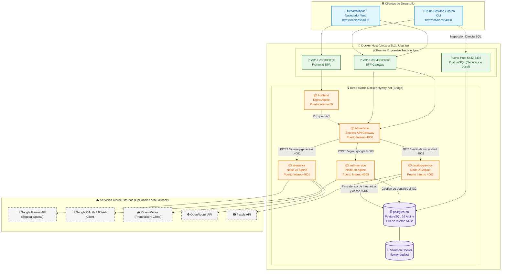
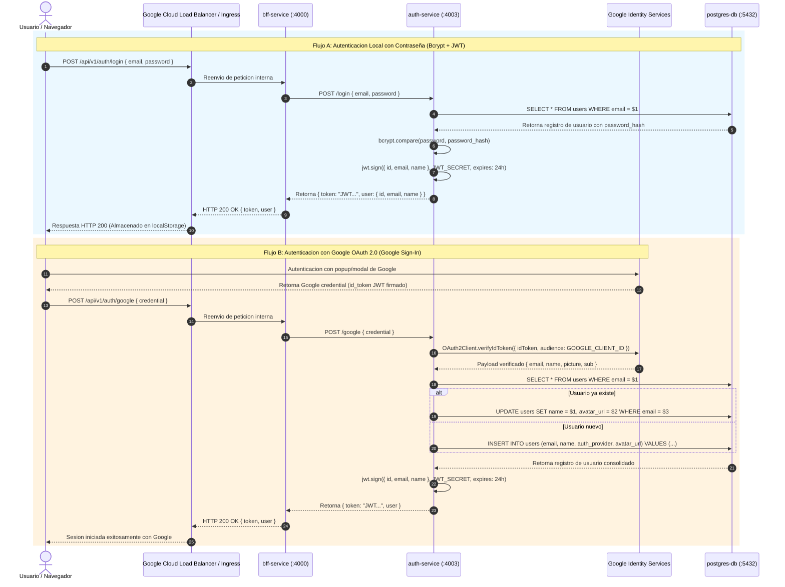
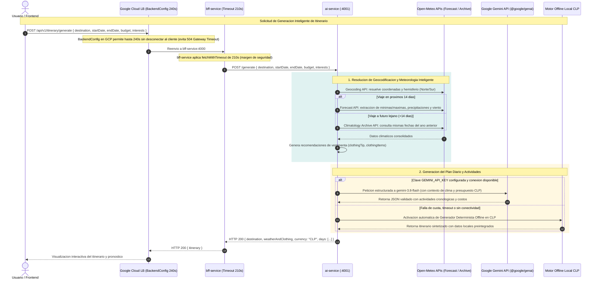
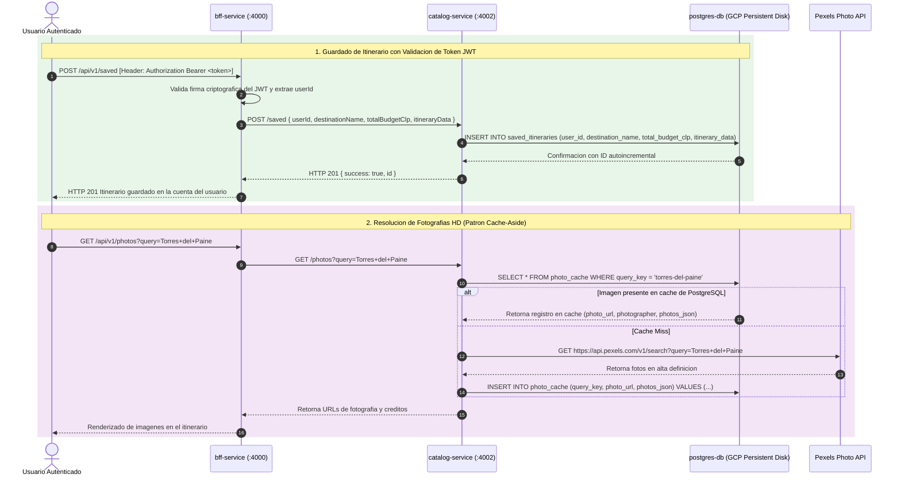

# 🗺️ Diagrama de Arquitectura, Contenedores y Topología de Red · Flyway

Este documento presenta la arquitectura integral de **Flyway**, detallando su topología de red, la interacción entre sus **6 contenedores/microservicios**, su infraestructura en la nube sobre **Google Cloud Platform (GCP)** mediante **Google Kubernetes Engine (GKE)**, su entorno local en **Docker Compose** y los flujos de comunicación con servicios externos e inteligencia artificial.

---

## 1. Topología de Red y Arquitectura de Contenedores en Google Cloud Platform (GCP / GKE)

El entorno de producción de Flyway está desplegado sobre la infraestructura cloud de **Google Cloud Platform (GCP)**, utilizando **Google Kubernetes Engine (GKE)** en modo Autopilot/Standard dentro de una Virtual Private Cloud (VPC) segura.

```mermaid
graph TB
    %% =========================================================================
    %% CAPA 1: CLIENTES Y ACCESOS EXTERNOS
    %% =========================================================================
    subgraph CLIENTS [" 🌐 Clientes Externos y Automatizacion "]
        User["👤 Usuario Final<br/>Navegador Web / SPA"]
        QA["🧪 Bruno CLI / Automated QA<br/>Pruebas de Contrato y Regresion"]
        GHActions["🚀 GitHub Actions Runner<br/>Pipeline CI/CD Automatizado"]
    end

    %% =========================================================================
    %% CAPA 2: GOOGLE CLOUD PERIMETER & INGRESS LAYER
    %% =========================================================================
    subgraph GCP_EDGE [" ☁️ Google Cloud Edge & Perimetro de Red "]
        CloudDNS["🌍 Cloud DNS & IP Publica Externa<br/>Anycast IP Reservada en GCP"]
        GCLB["🔀 Google Cloud External HTTP(S) Load Balancer<br/>Balanceador Global L7 Gestionado"]
        GKEIngress["🚪 GKE Ingress Controller<br/>kubernetes.io/ingress.class: gce<br/>flyway-ingress"]
        BackendCfg["⚙️ GCP BackendConfig<br/>cloud.google.com/v1 BackendConfig<br/>• timeoutSec: 240s<br/>• Health Check HTTP: /healthz:4000"]
    end

    %% =========================================================================
    %% CAPA 3: CLUSTER GOOGLE KUBERNETES ENGINE (GKE)
    %% =========================================================================
    subgraph GKE_CLUSTER [" ☸️ Cluster Google Kubernetes Engine (GKE Autopilot / Standard) "]
        
        %% Servicios de Kubernetes
        subgraph K8S_SERVICES [" Capa de Servicios K8s (Enrutamiento y DNS Interno CoreDNS) "]
            FrontendSvc["🌐 k8s Service: frontend<br/>Type: LoadBalancer / ClusterIP<br/>Puerto: 80/TCP"]
            BFFSvc["🔌 k8s Service: bff-service<br/>Type: ClusterIP (Puerto: 4000)<br/>Anotacion: bff-backend-config"]
            AuthSvc["🔒 k8s Service: auth-service<br/>Type: ClusterIP (Puerto: 4003)"]
            AISvc["🧠 k8s Service: ai-service<br/>Type: ClusterIP (Puerto: 4001)"]
            CatalogSvc["📚 k8s Service: catalog-service<br/>Type: ClusterIP (Puerto: 4002)"]
            PostgresSvc["🗄️ k8s Service: postgres-db<br/>Type: ClusterIP (Puerto: 5432)"]
        end

        %% Pods y Cargas de Trabajo (Deployments)
        subgraph K8S_PODS [" Pods de Microservicios (Namespace: default) "]
            
            FrontendPod["📦 Pod: frontend<br/>Nginx Alpine + React 19 SPA<br/>• Puerto Contenedor: 80<br/>• Enrutamiento SPA HTML5"]
            
            BFFPod["📦 Pod: bff-service<br/>Node.js 20 Alpine (Express)<br/>• Puerto: 4000<br/>• API Gateway & Enrutador<br/>• Timeout de IA: 210s<br/>• Readiness/Liveness: /healthz"]
            
            AuthPod["📦 Pod: auth-service<br/>Node.js 20 Alpine<br/>• Puerto: 4003<br/>• Hashing Bcrypt (Cost 10)<br/>• Emision y Validacion JWT<br/>• Google OAuth2Client verifyIdToken"]
            
            AIPod["📦 Pod: ai-service<br/>Node.js 20 Alpine<br/>• Puerto: 4001<br/>• Google Gemini SDK (@google/genai)<br/>• Motor Climatologico Open-Meteo<br/>• Resiliencia Local Offline en CLP"]
            
            CatalogPod["📦 Pod: catalog-service<br/>Node.js 20 Alpine<br/>• Puerto: 4002<br/>• Catalogo Destinos Chile y Mundo<br/>• Cache-Aside Pexels<br/>• Persistencia JSONB de Itinerarios"]
            
            PostgresPod[("🗄️ Pod: postgres-db<br/>PostgreSQL 16 Alpine<br/>• Puerto: 5432<br/>• SecurityContext fsGroup: 70<br/>• PGDATA: /data/pgdata<br/>• StartupProbe: 300s")]
        end

        %% Configuracion y Secretos de Kubernetes
        subgraph K8S_CONFIG [" Configuraciones y Secretos K8s "]
            ConfigMap["📄 ConfigMap: flyway-config<br/>URLs de Servicios, Puertos, Google Client ID"]
            InitSQL["📄 ConfigMap: postgres-init-sql<br/>DDL de Tablas, Indices y Destinos Seed"]
            Secrets["🔒 Secret: flyway-secrets<br/>JWT_SECRET, DB Passwords, API Keys"]
            GHCRSecret["🔒 Secret: ghcr-secret<br/>Credenciales Pull de GHCR"]
        end

        %% Capa de Almacenamiento Persistente en GCP
        subgraph GCP_STORAGE [" 💾 Almacenamiento Persistente en Google Cloud "]
            PVC["💾 PersistentVolumeClaim: postgres-pvc<br/>AccessMode: ReadWriteOnce (10Gi)"]
            GCP_PD[("💽 Compute Engine Persistent Disk<br/>StorageClass: standard-rwo<br/>Montaje: /var/lib/postgresql/data")]
        end
    end

    %% =========================================================================
    %% CAPA 4: SERVICIOS EXTERNOS Y APIS CLOUD
    %% =========================================================================
    subgraph EXTERNAL_SERVICES [" ☁️ Servicios Cloud Externos e Integraciones "]
        GeminiAPI["🤖 Google Gemini API<br/>Modelo: gemini-3.8-flash<br/>(@google/genai SDK)"]
        GoogleIdentity["🔐 Google Identity Services<br/>OAuth 2.0 Web Client Credentials"]
        OpenMeteoAPI["🌦️ Open-Meteo API<br/>• Geocoding API<br/>• Forecast API<br/>• Historical Climatology Archive"]
        OpenRouterAPI["🌐 OpenRouter API<br/>Fallback LLM Secundario"]
        PexelsAPI["📷 Pexels API<br/>Fotografia HD de Destinos"]
    end

    %% =========================================================================
    %% CAPA 5: DEVOPS, IAM & CI/CD EN GOOGLE CLOUD
    %% =========================================================================
    subgraph GCP_DEVOPS [" 🛠️ DevOps, IAM y Registro de Contenedores "]
        GCP_IAM["🔑 GCP IAM Service Account<br/>github-actions-gke<br/>Rol: roles/container.developer"]
        GHCR["📦 GitHub Container Registry (ghcr.io)<br/>Imagenes Multi-stage Linux/amd64"]
    end

    %% =========================================================================
    %% CONEXIONES Y FLUJOS DE RED
    %% =========================================================================
    
    %% Flujo de Trafico Entrante
    User -->|"HTTPS/HTTP :80 Trafico Web"| CloudDNS
    QA -->|"HTTP :4000 Test Suite"| CloudDNS
    CloudDNS --> GCLB
    GCLB --> GKEIngress
    
    %% Reglas de Ingress
    GKEIngress -->|"Path /* (SPA Estatica)"| FrontendSvc
    GKEIngress -->|"Path /api/* (API Gateway)"| BFFSvc
    BackendCfg -.->|"Aplica Timeout 240s y Sondeo /healthz"| BFFSvc

    %% Asociacion Servicios K8s -> Pods
    FrontendSvc --> FrontendPod
    BFFSvc --> BFFPod
    AuthSvc --> AuthPod
    AISvc --> AIPod
    CatalogSvc --> CatalogPod
    PostgresSvc --> PostgresPod

    %% Frontend comunicandose con API Gateway
    FrontendPod -.->|"Consumo Asincrono REST /api/v1"| BFFSvc

    %% Orquestacion desde BFF hacia Microservicios Internos
    BFFPod -->|"POST /login, /register, /google :4003"| AuthSvc
    BFFPod -->|"POST /itinerary/generate :4001"| AISvc
    BFFPod -->|"GET /destinations, /saved, /photos :4002"| CatalogSvc
    BFFPod -->|"GET /health :4001, :4002, :4003"| AISvc

    %% Conexiones con Base de Datos PostgreSQL
    AuthPod -->|"Gestion de usuarios y hash :5432"| PostgresSvc
    CatalogPod -->|"Catalogo, cache fotos y rutas JSONB :5432"| PostgresSvc

    %% Persistencia en GCP Persistent Disk
    PostgresPod --- PVC
    PVC --- GCP_PD

    %% Inyeccion de Configuraciones y Secretos
    ConfigMap -.->|"Inyeccion ENV"| K8S_PODS
    Secrets -.->|"Inyeccion Claves"| K8S_PODS
    InitSQL -.->|"Inicializacion DDL"| PostgresPod
    GHCRSecret -.->|"ImagePullSecret"| K8S_PODS

    %% Conexiones de Microservicios con APIs Externas
    AuthPod -->|"Verificacion de ID Token OAuth 2.0"| GoogleIdentity
    AIPod -->|"Generacion Primaria de Itinerarios"| GeminiAPI
    AIPod -->|"Generacion Secundaria de Respaldo"| OpenRouterAPI
    AIPod -->|"Geocodificacion y Analisis Climatologico"| OpenMeteoAPI
    CatalogPod -->|"Busqueda y Descarga de Fotos HD"| PexelsAPI

    %% Flujo CI/CD y Despliegue en GKE
    GHActions -->|"1. Autenticacion con gcp-key.json"| GCP_IAM
    GHActions -->|"2. Build & Push de 5 Imagenes"| GHCR
    GCP_IAM -->|"3. Deploy & Rollout automatico"| GKE_CLUSTER
    GHCR -.->|"Pull de imagenes productivas"| GKE_CLUSTER

    %% =========================================================================
    %% ESTILOS VISUALES
    %% =========================================================================
    classDef clientStyle fill:#e1f5fe,stroke:#0288d1,stroke-width:2px,color:#01579b;
    classDef edgeStyle fill:#e8eaf6,stroke:#3f51b5,stroke-width:2px,color:#1a237e;
    classDef k8sSvcStyle fill:#e0f2f1,stroke:#00897b,stroke-width:2px,color:#004d40;
    classDef podStyle fill:#fff3e0,stroke:#f57c00,stroke-width:2px,color:#e65100;
    classDef dbStyle fill:#ede7f6,stroke:#673ab7,stroke-width:2px,color:#311b92;
    classDef storageStyle fill:#fce4ec,stroke:#d81b60,stroke-width:2px,color:#880e4f;
    classDef extStyle fill:#f5f5f5,stroke:#616161,stroke-width:2px,stroke-dasharray: 4 4,color:#212121;
    classDef devopsStyle fill:#efebe9,stroke:#6d4c41,stroke-width:2px,color:#3e2723;

    class User,QA,GHActions clientStyle;
    class CloudDNS,GCLB,GKEIngress,BackendCfg edgeStyle;
    class FrontendSvc,BFFSvc,AuthSvc,AISvc,CatalogSvc,PostgresSvc k8sSvcStyle;
    class FrontendPod,BFFPod,AuthPod,AIPod,CatalogPod podStyle;
    class PostgresPod dbStyle;
    class PVC,GCP_PD storageStyle;
    class GeminiAPI,GoogleIdentity,OpenMeteoAPI,OpenRouterAPI,PexelsAPI extStyle;
    class GCP_IAM,GHCR devopsStyle;
```

---

## 2. Topología de Red en Entorno de Desarrollo Local (Docker Compose)

En estaciones de trabajo locales (Linux o Windows con **WSL2**), Flyway se ejecuta de forma integral orquestado por **Docker Compose**, utilizando una red interna tipo puente (*bridge*) llamada `flyway-net`:

---

## 3. Diagramas de Secuencia: Flujos de Negocio Críticos

### 3.1. Flujo de Autenticación Híbrida: Local (Bcrypt/JWT) y Google Sign-In (OAuth 2.0)

El sistema soporta registro y login tradicional con credenciales locales, y federación de identidades mediante **Google OAuth 2.0** validado criptográficamente en el backend:

---

### 3.2. Flujo de Generación de Itinerarios: Orquestación BFF, GCP BackendConfig y Resiliencia Multinivel

Este flujo detalla la generación de itinerarios turísticos combinando meteorología en tiempo real e histórica (Open-Meteo), inteligencia artificial (Gemini) y un motor offline determinista en pesos chilenos (CLP):

---

### 3.3. Flujo de Persistencia de Itinerarios y Patrón Cache-Aside de Fotografías (Pexels)

---

## 4. Matriz Técnica Comparativa: Docker Compose (Local) vs Google Cloud GKE (Producción)

| Dimensión de Infraestructura | Entorno Local (Docker Compose / WSL2) | Entorno de Producción Cloud (Google Cloud Platform - GKE) |
| :--- | :--- | :--- |
| **Orquestador** | Docker Compose v2 sobre Docker Engine / WSL2. | **Google Kubernetes Engine (GKE)** Autopilot o Standard. |
| **Ingress & Balanceo** | Enrutamiento directo mediante binding de puertos al Host (`3000:80`, `4000:4000`). | **Google Cloud External HTTP(S) Load Balancer (GCLB)** gestionado por GKE Ingress (`kubernetes.io/ingress.class: gce`). |
| **Manejo de Timeouts** | Limitado al timeout del socket de Node.js / navegador. | **GCP BackendConfig (`bff-backend-config`)** con `timeoutSec: 240` para evitar desconexiones prematuras de GCLB en llamadas de IA extensas. |
| **Sondeo de Salud (Probes)** | Bloques `healthcheck` básicos con `pg_isready` y `curl`. | `startupProbe` extendida (300s en PostgreSQL para migración DDL), `readinessProbe` y `livenessProbe` nativas de K8s conectadas al Load Balancer. |
| **Service Discovery** | Red bridge `flyway-net` con resolución DNS de Docker por nombre de contenedor (`http://auth-service:4003`). | **CoreDNS de Kubernetes** con nombres de servicio estándar (`auth-service`, `bff-service`, etc.) en el namespace `default`. |
| **Almacenamiento Persistente** | Docker Named Volume (`flyway-pgdata`) almacenado en el sistema de archivos del host. | **Google Compute Engine Persistent Disk (`standard-rwo`)** acoplado mediante `PersistentVolumeClaim` (`postgres-pvc`, 10Gi). |
| **Permisos de Almacenamiento** | Manejados automáticamente por el motor Docker en el host. | `securityContext` con `fsGroup: 70` en el Pod para garantizar permisos de escritura al UID `postgres` sobre volúmenes montados en GCP. |
| **Aislamiento de lost+found** | No suele interferir en volúmenes Docker locales. | Variable `PGDATA: /var/lib/postgresql/data/pgdata` obligatoria para eludir la carpeta del sistema de archivos `lost+found` en discos ext4 de GCP. |
| **Gestión de Secretos** | Archivo `.env` en la raíz del proyecto inyectado al levantar el compose. | **Kubernetes Secrets (`flyway-secrets`)** y **ConfigMaps (`flyway-config`)** sincronizados de forma segura sin exponer credenciales en repositorios. |
| **Autenticación Externa** | Credenciales opcionales; modo offline habilitado por defecto. | **Google OAuth 2.0 Web Client ID** configurado en Google Cloud Console e inyectado a Frontend y Auth Service. |
| **Despliegue y CI/CD** | `docker compose up --build -d` manual en terminal WSL2. | Pipeline automatizado en **GitHub Actions (`ci-cd.yml`)** autenticado mediante **GCP IAM Service Account (`github-actions-gke`)**. |

---

## 5. Resumen de Políticas de Seguridad, Resiliencia y Red en GCP

1. **Segregación Estricta de Tráfico:**
   - Únicamente los servicios `frontend` y `bff-service` son accesibles desde el perímetro externo a través de las rutas definidas en el Ingress (`/*` y `/api/*`).
   - Los microservicios de lógica de negocio (`auth-service`, `ai-service`, `catalog-service`) y la base de datos (`postgres-db`) están configurados como servicios de tipo `ClusterIP`, inaccesibles desde el exterior y protegidos en la red interna de Kubernetes.

2. **Alineación de Timeouts en Cascada para Inteligencia Artificial:**
   - Para soportar la generación de itinerarios complejos de hasta 7 días con modelos avanzados de IA sin caídas de conexión, los tiempos de espera están rigurosamente calibrados:
     $$\text{GCP BackendConfig (240s)} > \text{BFF Gateway (210s)} > \text{AI Service Engine (180s)} > \text{Llamadas HTTP (60s)}$$
   - Esto previene que el Load Balancer de Google Cloud cierre la conexión con un error `504 Gateway Timeout` antes de que el microservicio de IA finalice la serialización del JSON.

3. **Resiliencia ante Desconexión o Agotamiento de Cuotas:**
   - Si la API de Google Gemini no responde o se agotan las cuotas del proyecto en la nube, el microservicio `ai-service` conmuta instantáneamente al motor determinista local en pesos chilenos (CLP).
   - Si la base de datos PostgreSQL se reinicia o sufre latencia durante el despliegue en GCP, `auth-service` y `catalog-service` poseen mecanismos de manejo de excepciones y reintentos automáticos para evitar errores fatales en los pods.

4. **Integridad y Seguridad en Almacenamiento Cloud:**
   - La base de datos almacena los datos de forma durable en un **Compute Engine Persistent Disk**. El uso del subdirectorio `/pgdata` previene que PostgreSQL aborte su inicialización debido a la presencia de directorios reservados de Linux (`lost+found`), garantizando despliegues y reinicios completamente desatendidos.
