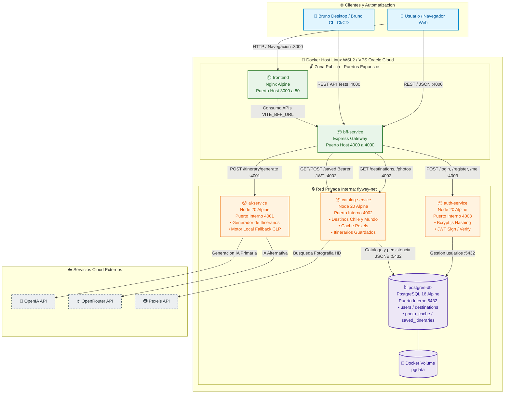
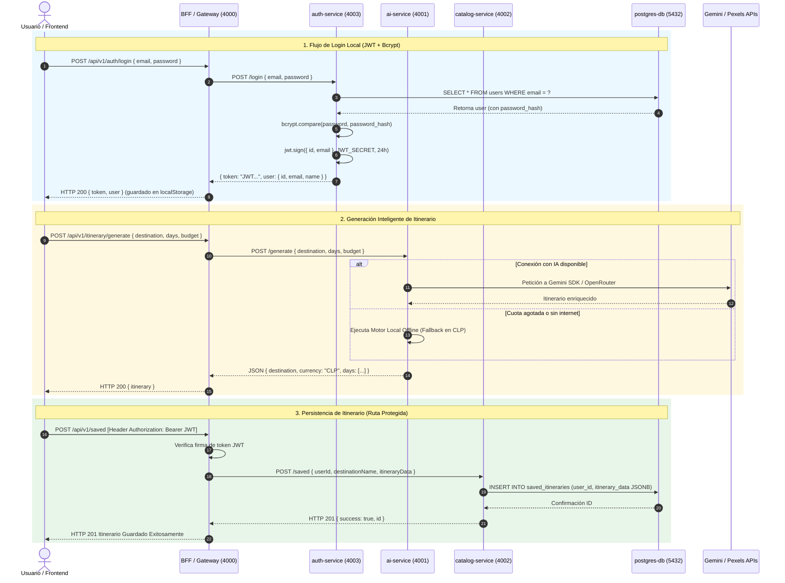

# 🗺️ Diagrama de Arquitectura y Topología de Red · Flyway

Este documento contiene los diagramas en **Mermaid** que representan la interacción entre los **6 contenedores** del proyecto Flyway, la segregación de red en Docker y el flujo de llamadas entre microservicios, clientes y servicios externos.

---

## 1. Diagrama de Contenedores y Topología de Red (Docker)

---

## 2. Diagrama de Secuencia: Flujo de Autenticación y Generación de Itinerarios

Este diagrama ilustra la interacción paso a paso entre los servicios cuando un usuario inicia sesión y solicita un itinerario protegido:

---

## 3. Resumen de Seguridad y Segregación de Red

1. **Sin exposición innecesaria:** Ni `auth-service`, ni `ai-service`, ni `catalog-service`, ni `postgres-db` exponen puertos al exterior en el `docker-compose.prod.yml`. Solo el puerto `3000` (Frontend) y el `4000` (BFF) son accesibles.
2. **Defensa perimetral:** El **BFF** valida el encabezado `Authorization: Bearer <token>` antes de transferir datos al `catalog-service`.
3. **Resiliencia desacoplada:** Si la base de datos se satura o la API de Gemini agota cuota, `ai-service` mantiene vivo el servicio mediante su motor determinista en pesos chilenos (CLP).