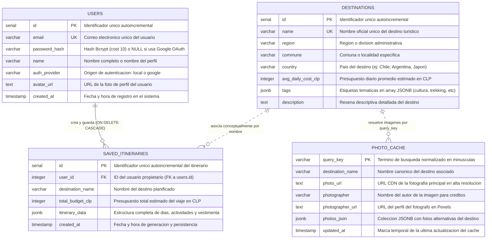

# 🗄️ Modelo de Base de Datos y Persistencia · Flyway

Este documento describe la arquitectura de datos, el diagrama entidad-relación (**ERD**), el diccionario de tablas, los índices de optimización y la estrategia de almacenamiento persistente en **Google Cloud Platform (GCP)** para la base de datos PostgreSQL 16 de Flyway.

---

## 1. Diagrama Entidad-Relación (Mermaid ERD)



---

## 2. Diccionario de Datos y Especificación de Tablas

### 2.1. Tabla: `users`
Almacena las cuentas de usuario de la plataforma, soportando tanto autenticación local (contraseña con hash Bcrypt) como federada mediante **Google OAuth 2.0**.

| Columna | Tipo de Dato | Nulable | Restricciones / Valor por Defecto | Descripción Funcional |
| :--- | :--- | :--- | :--- | :--- |
| `id` | `SERIAL` | **NO** | `PRIMARY KEY` | Identificador único autoincremental del usuario en la plataforma. |
| `email` | `VARCHAR(255)` | **NO** | `UNIQUE` | Correo electrónico principal, utilizado para inicio de sesión y sincronización con Google. |
| `password_hash` | `VARCHAR(255)` | SÍ | `NULL` permitido para Google Sign-In | Hash seguro generado con **Bcrypt.js** (factor de costo 10). En cuentas creadas vía Google OAuth permanece en `NULL`. |
| `name` | `VARCHAR(100)` | **NO** | - | Nombre completo del usuario extraído del formulario o del perfil de Google. |
| `auth_provider` | `VARCHAR(50)` | SÍ | `DEFAULT 'local'` | Identificador del proveedor de identidad (`'local'` para credenciales propias o `'google'` para OAuth 2.0). |
| `avatar_url` | `TEXT` | SÍ | `NULL` | Enlace a la imagen de perfil provista por Google Identity Services o un avatar asignado. |
| `created_at` | `TIMESTAMP` | SÍ | `DEFAULT CURRENT_TIMESTAMP` | Momento exacto de registro en la base de datos. |

---

### 2.2. Tabla: `destinations`
Catálogo vivo de destinos turísticos con información geográfica, comunal, económica y etiquetas temáticas.

| Columna | Tipo de Dato | Nulable | Restricciones / Valor por Defecto | Descripción Funcional |
| :--- | :--- | :--- | :--- | :--- |
| `id` | `SERIAL` | **NO** | `PRIMARY KEY` | Identificador único autoincremental del destino. |
| `name` | `VARCHAR(150)` | **NO** | `UNIQUE` | Nombre representativo del destino (ej: *Santiago*, *Pucón*, *Torres del Paine*, *Tokio*). |
| `region` | `VARCHAR(150)` | SÍ | - | Región, provincia o división política administrativa. |
| `commune` | `VARCHAR(150)` | SÍ | - | Comuna, distrito o sector geográfico de referencia. |
| `country` | `VARCHAR(100)` | SÍ | - | País de ubicación del destino. |
| `avg_daily_cost_clp`| `INTEGER` | SÍ | - | Costo promedio diario estimado en pesos chilenos (CLP) para alimentación, transporte y actividades básicas. |
| `tags` | `JSONB` | SÍ | `DEFAULT '[]'::jsonb` | Arreglo JSONB de categorías temáticas (ej: `["aventura", "naturaleza", "termas"]`). Permite búsquedas indexadas de alta velocidad. |
| `description` | `TEXT` | SÍ | - | Reseña turística, atractivos destacados y contexto cultural. |

---

### 2.3. Tabla: `saved_itineraries`
Guarda los planes de viaje generados por el motor de inteligencia artificial asociados a la cuenta del usuario autenticado.

| Columna | Tipo de Dato | Nulable | Restricciones / Valor por Defecto | Descripción Funcional |
| :--- | :--- | :--- | :--- | :--- |
| `id` | `SERIAL` | **NO** | `PRIMARY KEY` | Identificador único autoincremental de la ruta guardada. |
| `user_id` | `INTEGER` | SÍ | `REFERENCES users(id) ON DELETE CASCADE` | Llave foránea hacia el usuario creador. Si el usuario se elimina, sus itinerarios se borran automáticamente en cascada. |
| `destination_name`| `VARCHAR(150)` | SÍ | - | Nombre del destino principal sobre el cual se planificó el viaje. |
| `total_budget_clp`| `INTEGER` | SÍ | - | Presupuesto total consolidado de la estancia en pesos chilenos (CLP). |
| `itinerary_data` | `JSONB` | **NO** | - | Documento documental JSONB con el desglose cronológico completo: días, actividades por franja horaria, consejos de viaje, pronóstico meteorológico y lista de vestimenta sugerida. |
| `created_at` | `TIMESTAMP` | SÍ | `DEFAULT CURRENT_TIMESTAMP` | Marca temporal del momento en que el usuario guardó el itinerario. |

---

### 2.4. Tabla: `photo_cache`
Implementa el patrón de diseño arquitectónico **Cache-Aside** para almacenar en caché fotografías obtenidas desde la API externa de **Pexels**, mitigando la latencia y previniendo el agotamiento de cuotas de red.

| Columna | Tipo de Dato | Nulable | Restricciones / Valor por Defecto | Descripción Funcional |
| :--- | :--- | :--- | :--- | :--- |
| `query_key` | `VARCHAR(255)` | **NO** | `PRIMARY KEY` | Término de búsqueda normalizado en minúsculas y sin caracteres especiales (clave de acceso al caché). |
| `destination_name`| `VARCHAR(150)` | SÍ | - | Nombre canónico del destino consultado. |
| `photo_url` | `TEXT` | **NO** | - | Enlace directo CDN a la fotografía principal en alta resolución. |
| `photographer` | `VARCHAR(150)` | SÍ | - | Nombre del fotógrafo acreditado según los términos de uso de Pexels. |
| `photographer_url`| `TEXT` | SÍ | - | Perfil web del fotógrafo en la plataforma Pexels. |
| `photos_json` | `JSONB` | SÍ | `DEFAULT '[]'::jsonb` | Arreglo JSONB con una galería de fotografías secundarias para alimentar la interfaz gráfica. |
| `updated_at` | `TIMESTAMP` | SÍ | `DEFAULT CURRENT_TIMESTAMP` | Fecha y hora en la que se actualizó o guardó el registro en la caché. |

---

## 3. Estrategia de Índices y Optimización de Consultas

Para mantener tiempos de respuesta en el rango de los milisegundos en entornos de alta concurrencia, el esquema incluye índices especializados en PostgreSQL:

```sql
-- 1. Búsqueda eficiente de destinos insensible a mayúsculas y acentos:
CREATE INDEX IF NOT EXISTS idx_destinations_name_lower 
ON destinations(LOWER(name));

-- 2. Filtrado rápido de destinos por país:
CREATE INDEX IF NOT EXISTS idx_destinations_country 
ON destinations(country);

-- 3. Índice Invertido Generalizado (GIN) para búsqueda instantánea en tags JSONB:
-- Permite ejecutar consultas de contención como: WHERE tags ? 'aventura'
CREATE INDEX IF NOT EXISTS idx_destinations_tags 
ON destinations USING GIN(tags);

-- 4. Búsqueda acelerada de itinerarios por usuario autenticado:
CREATE INDEX IF NOT EXISTS idx_saved_itineraries_user_id 
ON saved_itineraries(user_id);

-- 5. Ordenamiento cronológico de los itinerarios más recientes:
CREATE INDEX IF NOT EXISTS idx_saved_itineraries_created_at 
ON saved_itineraries(created_at DESC);
```

---

## 4. Persistencia e Infraestructura en Google Cloud Platform (GCP / GKE)

La base de datos relacional de producción se ejecuta sobre **PostgreSQL 16 Alpine** dentro del clúster de **Google Kubernetes Engine (GKE)**, con las siguientes características técnicas clave:

1. **Almacenamiento Persistente en Compute Engine:**
   - Montado a través de un `PersistentVolumeClaim` (`postgres-pvc`) de **10Gi** con clase de almacenamiento estándar (`standard-rwo`).
   - El volumen se desacopla del ciclo de vida del Pod, garantizando que reinicios, migraciones de nodo en GKE o actualizaciones de imagen no comprometan los datos almacenados.

2. **Resolución de Permisos y Sistema de Archivos (`fsGroup: 70`):**
   - Los discos virtuales formateados en Linux (ext4) montados en GCP asignan inicialmente los permisos a `root (UID 0)`.
   - La especificación del Pod configura:
     ```yaml
     securityContext:
       fsGroup: 70
       fsGroupChangePolicy: "OnRootMismatch"
     ```
     Esto garantiza que el usuario interno `postgres` de Alpine (cuyo UID es `70`) disponga de permisos completos de lectura y escritura sin necesidad de ejecutar contenedores privilegiados.

3. **Prevención de Colisión con `lost+found` (`PGDATA`):**
   - Los sistemas de archivos ext4 en la nube crean automáticamente un directorio reservado `lost+found` en la raíz del punto de montaje (`/var/lib/postgresql/data`). Si PostgreSQL detecta archivos no pertenecientes al clúster, aborta el comando `initdb`.
   - Para eludir este comportamiento, se establece la variable de entorno:
     ```yaml
     - name: PGDATA
       value: /var/lib/postgresql/data/pgdata
     ```
     Almacenando el clúster de datos en una subcarpeta limpia y aislada.

4. **Sonda de Inicio de Resiliencia Extendida (`startupProbe`):**
   - Durante el primer despliegue en GCP, PostgreSQL ejecuta el script de inicialización DDL y datos semilla desde el ConfigMap `postgres-init-sql`.
   - La sonda `startupProbe` otorga un margen de hasta **300 segundos** (`failureThreshold: 30`, `periodSeconds: 10`), impidiendo que Kubelet reinicie el contenedor prematuramente mientras se configuran las tablas y los índices.

---

## 5. Catálogo de Datos Semilla (Seed Data)

### 5.1. Usuario de Demostración Local y Testing
El script `init.sql` inicializa automáticamente una cuenta para pruebas funcionales y suites automatizadas de QA con Bruno:
* **Email:** `demo@flyway.cl`
* **Contraseña:** `flyway123`
* **Hash Bcrypt (costo 10):** `$2a$10$2kSgvJqGLXzH8LMF3KAZH.QS3M6pErF3.ZYMqLQHUtvhfmMNWcKEm`

### 5.2. Destinos Iniciales Precargados
El catálogo cuenta con destinos sembrados con costos diarios promedio, etiquetas temáticas y descripciones geográficas:

* **Destinos en Chile:**
  - **Santiago** (Región Metropolitana) · Costo promedio: $55.000 CLP · Tags: cultura, gastronomía, naturaleza, museos, parques.
  - **Valparaíso** (Región de Valparaíso) · Costo promedio: $45.000 CLP · Tags: cultura, arte, bohemia, gastronomía, patrimonio.
  - **San Pedro de Atacama** (Región de Antofagasta) · Costo promedio: $75.000 CLP · Tags: naturaleza, aventura, arqueología, astronomía.
  - **Pucón** (Región de la Araucanía) · Costo promedio: $65.000 CLP · Tags: aventura, naturaleza, termas, trekking, volcanes.
  - **Torres del Paine** (Región de Magallanes) · Costo promedio: $95.000 CLP · Tags: aventura, patagonia, naturaleza, trekking, fauna.
  - **Chiloé** (Región de Los Lagos) · Costo promedio: $48.000 CLP · Tags: cultura, mitología, gastronomía, iglesias, naturaleza.

* **Destinos Internacionales:**
  - **Buenos Aires** (Argentina) · $45.000 CLP · Tags: cultura, gastronomía, tango, vida nocturna.
  - **Río de Janeiro** (Brasil) · $55.000 CLP · Tags: playa, naturaleza, música, cultura.
  - **Cusco y Machu Picchu** (Perú) · $58.000 CLP · Tags: historia, arqueología, cultura, trekking.
  - **Tokio** (Japón) · $85.000 CLP · Tags: tecnología, gastronomía, cultura, urbano.
  - **París** (Francia) · $95.000 CLP · Tags: arte, arquitectura, gastronomía, romance.
  - **Roma** (Italia) · $80.000 CLP · Tags: historia, arquitectura, gastronomía, ruinas.
  - **Nueva York** (Estados Unidos) · $115.000 CLP · Tags: urbano, cultura, espectáculos, compras.
  - **Madrid** (España) · $72.000 CLP · Tags: cultura, tapas, museos, historia.
